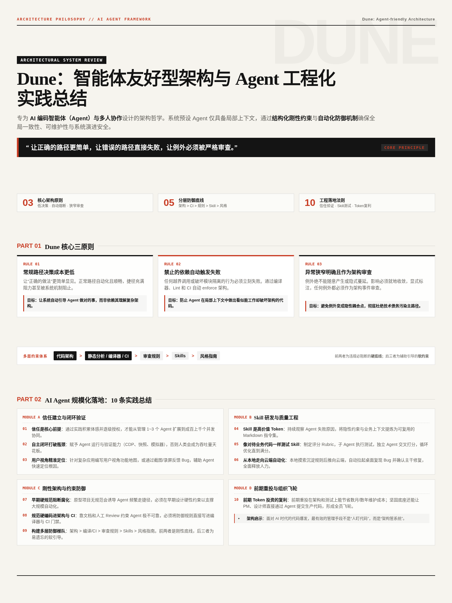

# Dune：智能体友好型架构与 Agent 工程化实践总结

Dune 是一种专为 **AI 编码智能体（Agent）与多人协作**设计的架构哲学。它假设开发者或智能体通常只看到局部上下文，因此系统必须通过结构化约束来确保全局一致性、可维护性与安全性。

---

## 一、Dune 核心三原则

### 1. 常规路径比捷径需要更少的决策
架构必须让“正确的做法”更简单、更显而易见，让开发者或 AI 自然地走向安全路径。  
- **正常路径**：清晰、自动化、低决策成本。  
- **捷径**：复杂、容易破坏边界、应当被机制阻止。  
- **目标**：让系统自动引导 Agent 做对的事，而不是依赖 Agent 理解复杂架构。

---

### 2. 禁止的依赖关系会自动触发失败机制
任何跨越边界、破坏模块隔离的行为都必须立即失败。  
- **自动化拦截**：违反依赖 → 编译失败 / Lint 失败 / CI 拒绝。  
- **机制保障**：系统自动 Enforce 架构边界，而不是靠人类记忆或提醒。  
- **目标**：防止 AI Agent 在局部上下文中做出“看似能工作但破坏架构”的修改。

---

### 3. 异常情况应当狭窄、明确，并作为架构变更进行审查
例外不能随意出现，也不能隐式存在。  
- **狭窄**：影响范围小，严格就地限制，不向外扩散。  
- **明确**：显式标注，不让 Agent 误以为这是常规模式并加以模仿。  
- **审查**：任何例外都是重大的“架构事件”，而非普通的代码变更。  
- **目标**：避免例外演变成隐性耦合点与技术债务，污染系统主路径。

---

## 二、整体思想（一句话版）

> **让正确的路径更简单，让错误的路径直接失败，让例外必须被严格审查。**

这样 AI Agent 即使只看到局部上下文，也能安全地做出“局部显而易见且全局正确”的高质量修改。

---

## 三、AI Agent 规模化工程落地：10 条实践总结

### 1. 建立信任与逐步授权
用好 AI 的核心问题是**信任**。需要通过持续的实践积累工程体感，然后逐级把后背交给它。只有这样，才能从最初管理 1～3 个 Agent，平滑扩展到调度成百上千个 Agent 并发协作。

### 2. 闭环验证是信任的前提
如果 Agent 无法自主验证，**人就会成为整个系统吞吐量的最大瓶颈**。必须赋予 Agent 真实的运行与验证环境，例如调用 Chrome DevTools Protocol (CDP)、抓取 CPU/内存快照、驱动自动化测试与模拟器等。

### 3. 用户视角功能地图与精准定位
面对复杂前端或大型应用时，Agent 往往难以定位修改点。可以按照**用户视角编写功能地图**，或通过**截图与 UI 录屏**形式反馈 Bug，帮助 Agent 快速建立上下文并精准定位问题根因。

### 4. Skill 是高价值的业务 Token
Skill 是向 Agent 注入特定业务上下文的高质量 Token。应持续观察 Agent 的失败原因与反模式，将各种经验与隐性约束提炼为可复用的 Markdown 指令集，从而显著提升 Agent 的输出质量与稳定性。

### 5. 像对待业务代码一样测试 Skill
必须为 Agent 的 Skill 编写“单元测试”。一种有效范式是：
- 协调 Agent 拟定评分细则（Rubric）；
- 驱动子 Agent 执行具体测试任务；
- 引入独立的 Judge Agent 交叉打分与审查；
- 配合循环机制持续迭代，直到达到满分标准。

### 6. 从本地观察走向云端自动化
- **初期**：在本地细致观察 Agent 的执行路径与行为模式，沉淀经验与规则；
- **成熟期**：全面推向云端自动化。例如收到 Bug 反馈后，自动在云端拉起无头/桌面环境复现问题，并自动验证是否已在主干分支修复，彻底解放人工排查与验证成本。

### 7. 严格硬性规范阻断架构腐化
缺乏规范的原型项目会诱导 Agent 频繁走捷径，导致代码库急剧腐化。必须在项目早期就设计并确立严格的硬性规范，唯有坚固的地基才能承载大规模的代码自动化生成。

### 8. 规范必须硬编码进架构与 CI
依靠文档说明和人类 Code Review 来约束 Agent 是不可靠的。人类容易疏忽，Agent 容易丢失长上下文。必须将规范**硬编码到编译器、架构设计以及 CI 门禁**中。

### 9. 构建多层约束防御体系
不同约束层级的有效性与防御强度顺序为：

> **`代码架构` > `静态分析 / 编译器 / CI` > `审查规则` > `Skills` > `风格指南`**

- **硬底线**（前两者）：系统必须绝对守住的质量防线，代码违规即直接阻断构建或合并。
- **软约束**（后三者）：Agent 容易遗忘或偶发越界，主要作为辅助上下文与编码引导。

### 10. 前期 Token 投资的复利与飞轮
前期把大量 Token 投资在**架构设计、边界约束与自动化测试**上，能够节省后续数月乃至数年的人力维护成本。一个结构清晰、自验证、高容错的工程底座，还能让产品经理、设计师等非研发角色直接通过 Agent 提交生产级可用代码，形成组织级的协同飞轮。

---

**参考来源**：[X / @kingwilliam_](https://x.com/kingwilliam_/status/2097399251475038720/video/1)
